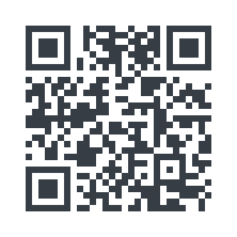

# [Before We Start]{.flow} {.title}

<!-- Start-of-course survey, open until 2026-10-20. After that, remove the
     include line in introduction.qmd; this file stays for the next course.
     The announcement is a speaker note and only exists in the deck. -->

::: {.content-visible when-format="revealjs"}
::: {.notes}
**Say this before anyone scans (fixed wording):**

"Before we start, I would like to ask you for five to eight minutes for a short survey. It is part of my Master's thesis on AI chatbots in teaching. Participation is voluntary and without names: whether you take part has no effect on your grade, and I make no attempt to find out who participates or who answers what. Honest answers help me most, and that explicitly includes critical ones."

Then, in your own words:

- There are no right or wrong answers. "Never" and "don't know yet" are perfectly fine.
- You don't need to memorise the code, you build it again by the same rule at the end of the semester. Use first names as in the passport, and the first one if there are several.
- No connection or not finished: the link stays open for one week. Please fill it in only once.

Next slide: the code stays up for eight minutes.
:::
:::

## Start-of-Course Survey

::: {.columns}

::: {.column width="48%"}
{width="540" fig-alt="QR code linking to the start-of-course survey, the same address as the link next to it."}
:::

::: {.column width="52%"}

5–8 minutes, [voluntary]{.highlight} and [without names]{.highlight}

**[tally.so/r/KY75N8?kurs=ao](https://tally.so/r/KY75N8?kurs=ao)**

:::

:::
