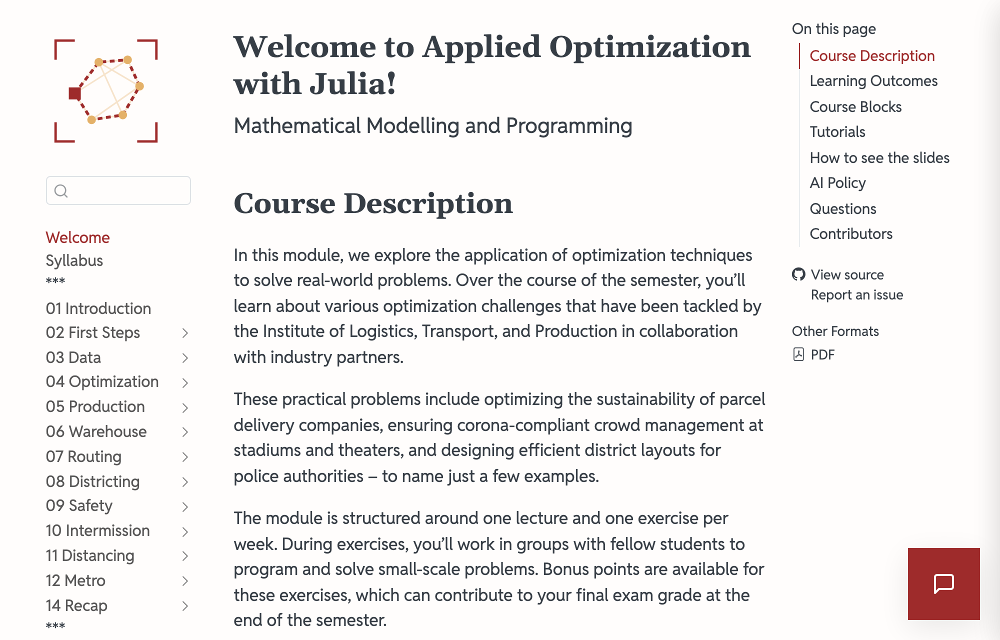
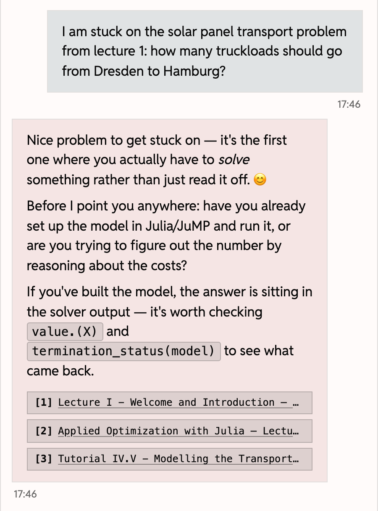



# [The Course Chatbot]{.flow} {.title}

## What Is It?

::: {.columns}

::: {.column width="42%"}
- An [AI chatbot]{.highlight} that knows the materials of this course
- You find it on [every page]{.highlight} of the course website
- Open it with the red button at the bottom right
:::

::: {.column width="58%"}
{fig-alt="Screenshot of the welcome page of the course website; a red button with a speech bubble sits in the bottom right corner and opens the course chatbot."}
:::

:::

## How Does It Answer?

- It gives [hints rather than complete solutions]{.highlight}
- So that you work out the next step yourself

. . .

- Below each answer you see the [passages from the course materials]{.highlight} it is based on

## {.loud-slide}
::: {.r-fit-text}
Let's ask it

a question!
:::

::: {.content-visible when-format="revealjs"}
::: {.notes}
Live demo, two minutes: open the course website, click the red button and type:

"I am stuck on the solar panel transport problem from lecture 1: how many truckloads should go from Dresden to Hamburg?"

Point out the hint and the sources below it. No network: the next slide shows the same conversation.
:::
:::

## A Question on Lecture 1

::: {.columns}

::: {.column width="38%"}
{fig-alt="Screenshot of a conversation with the course chatbot. The student asks how many truckloads should go from Dresden to Hamburg in the solar panel transport problem. The chatbot answers with a question back, whether the model is already set up in Julia or the costs are being reasoned through, and lists three sources below the answer: lecture 1 twice and tutorial IV.V."}
:::

::: {.column width="62%"}
[Question:]{.question} How many truckloads should go from Dresden to Hamburg?

. . .

- The answer is a [hint]{.highlight}: a question back, not the number
- Below it are the [sources]{.highlight}: here lecture 1 and a tutorial
:::

:::

## What Happens to Your Chats?

- Conversations are [stored without names]{.highlight}
- They are analysed to improve teaching and for scientific research

. . .

- [Please do not enter personal data!]{.highlight}

. . .

:::{.callout-note}
The details are on the [privacy page](../general/privacy.qmd).
:::

## Do You Have to Use It?

- No: [using the course chatbot is voluntary]{.highlight}
- **Studying:** You may use external AI tools (e.g., ChatGPT, Claude, Mistral, Gemini)
- **Bonus assignments:** Every submission that used AI says so, in one honest line
- **Exam:** AI tools are not permitted

. . .

:::{.callout-note}
The full AI policy is on the [welcome page](../index.qmd#ai-policy).
:::

## A Complement, Not a Replacement

The course chatbot [complements]{.highlight} the lectures and the tutorials.

. . .

It [does not replace]{.highlight} them!

. . .

:::{.callout-tip}
Bring your questions to the lectures and the tutorials, just as before!
:::

## {.loud-slide}
::: {.r-fit-text}
Any questions?
:::

::: {.content-visible when-format="revealjs"}
::: {.notes}
If asked:

- Platform: oshu.eu, developed by me. Language model: Mistral Large 4.
- No login, no names. Strictly necessary cookies let you continue a conversation for about 24 hours.
- The survey and the chatbot conversations cannot be linked to each other.
- Whether you use the chatbot or take part in the survey has no effect on your grade. There are no bonus points for either.

Research diary: date, start of the survey, start of the introduction, duration, number present, number enrolled, which of the eight points were left out.
:::
:::
