# [Introduction]{.flow} {.title}

## [Rural Public Transport]{.invert-font} {background-color="#000000" background-image="https://images.unsplash.com/photo-1635395865970-77976b63909f?q=80&w=3000&auto=format&fit=crop" background-size="cover" background-position="center"}

::: {.footer}
:::

## Learning Objectives

After this lecture, you will be able to:

::: {.incremental}

- **Model** bus scheduling as a network flow on a time-feasible graph
- **Explain** why this network flow returns whole bus tours
- **Adapt** the graph to serve only the booked trips
- **Assess** how seats, shifts, and breaks change the problem

:::

## Empty Buses, Long Waits

- Demand is [low and spread out]{.highlight} over many villages
- Fixed timetables mean that buses **often run empty**
- Few departures mean **long waits** for the passengers
- Still, public transport is part of the **basic public services**

. . .

[Question:]{.question} **What could an operator do about it?**

## On-Demand Line Buses

A [hybrid]{.highlight} between fixed-route transit and ride-pooling:

::: {.incremental}
- **Fixed routes:** buses follow the lines and stops of the timetable
- **On demand:** a bus only runs if somebody books it
- **Booking:** via app or phone, at least one hour in advance
- **No booking:** the bus simply stays in the depot
:::

. . .

[Question:]{.question} **What could be the advantages?**

## Advantages

- Passengers on the same line [share one bus]{.highlight}
- No **empty runs** on trips without bookings
- Especially valuable for **low and spread-out demand**

. . .

::: {.callout-note}
### Note: Demand-responsive transport
Such services are part of a broad family of demand-responsive bus systems. For an overview, see @vansteenwegen_survey_2022.
:::

## Case Study

- A bus operator in [a rural region in northern Germany]{.highlight}
- **Six depots**, which we call Depot A to Depot F
- **76 days** of bookings from June to August 2025
- 36,414 bookings, of which [47.2% were rejected]{.highlight}
- 96% of all bookings are for a **single passenger**

. . .

::: {.callout-note}
### Note: Small buses
Although marketed as a bus service, the buses are passenger cars with **three or five seats**. All depots together run 41 of them in 45 driver shifts per day.
:::

## {.loud-slide}
::: {.r-fit-text}
Almost every

second booking

is rejected!
:::

::: footer
:::

## Demand Patterns

Rows are depots, columns are hours. Look along the rows:

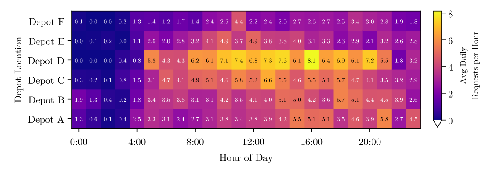{fig-align="center" width=74% fig-alt="Heatmap of the average daily bookings per hour for Depots A to F. Demand is close to zero at night and forms a broad plateau from about 5:00 to 23:00, with Depot D reaching up to 8 bookings per hour."}

. . .

- No morning and evening peaks, but a [broad plateau]{.highlight}
- The operator needs **buses throughout the day**

## Current Dispatch

- A **rule-based software** assigns each booking when it arrives
- The booking is confirmed if a bus is free, otherwise rejected

. . .

[Question:]{.question} **Could a better plan serve more bookings with the same buses?**

. . .

- That is exactly what we will analyze in this lecture
- But first: [how many buses]{.highlight} do we need at all?

## {.loud-slide}
::: {.r-fit-text}
Let's take a

closer look at the

problem structure!
:::

::: footer
:::

# [Problem Structure]{.flow} {.title}

## Objective

[Question:]{.question} **What could be the objectives of the operator?**

. . .

- Serve [as many bookings as possible]{.highlight}
- Use [as few buses and drivers]{.highlight} as possible
- Offer a **reliable** service that people can trust

. . .

::: {.callout-note}
### Note: We start with the number of buses
First, we ask how many buses we need **at least** to serve **all** bookings. Later, we turn the question around and ask how many bookings a given set of buses can serve.
:::

## One Region, One Day

Time runs left to right; each line has its own area:

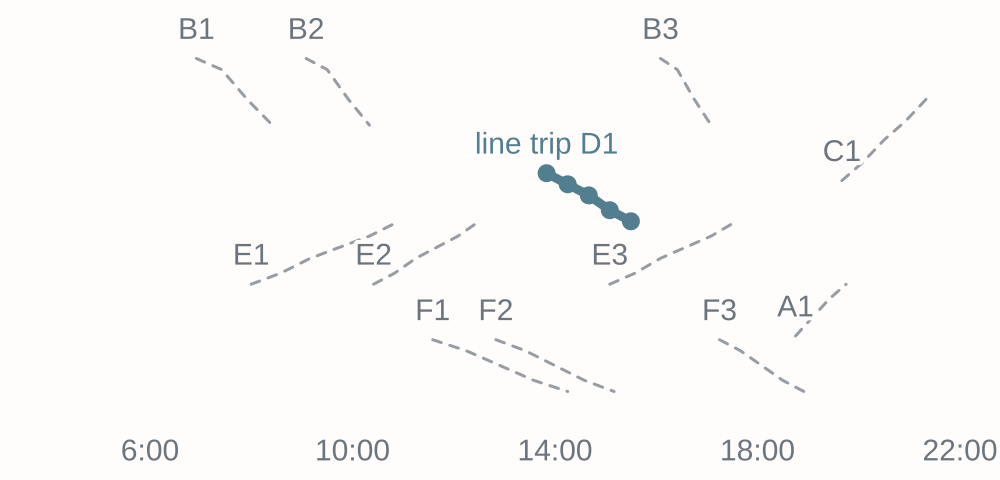{fig-align="center" width=56% fig-alt="Six bus lines, each in its own part of the region, over the day from 6:00 to 22:00: twelve line trips, named by line and number. Line trip D1, from 13:50 to 15:30 with five stops, is picked out."}

- Each dashed line is a [line trip]{.highlight}: one line at one start time
- A bus crosses the whole region in **4 hours**

## S1: Every Trip Runs

Shaded is where buses drive, dark are the nine bookings:

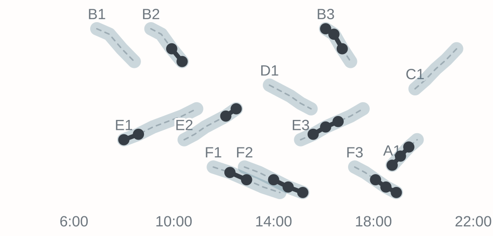{fig-align="center" width=72% fig-alt="Service scope S1 on the class day: all twelve line trips run in full, shaded, under the nine bookings."}

- Like a classic timetable: all twelve line trips run in full

## S2: Booked Trips Run

Shaded is where buses drive, dark are the nine bookings:

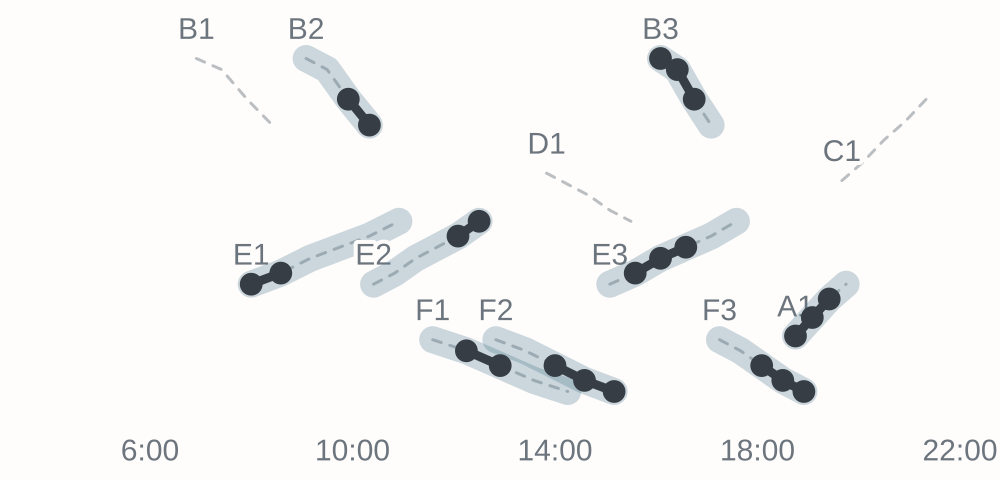{fig-align="center" width=72% fig-alt="Service scope S2 on the class day: the nine line trips with a booking run in full, shaded; the three without a booking stay faint."}

- A line trip runs in full if [anybody books it]{.highlight} [@pei_realtime_2019]

## S3: Only Bookings Run

Shaded is where buses drive, dark are the nine bookings:

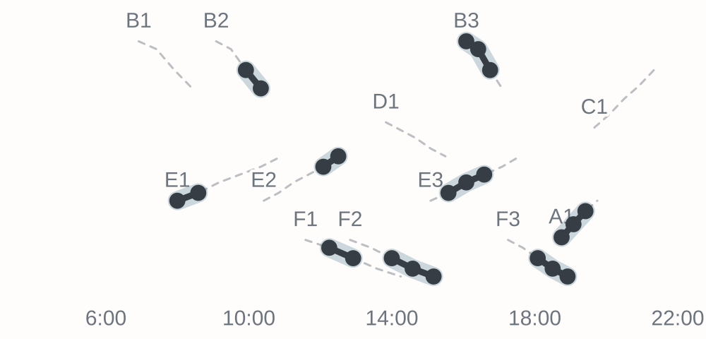{fig-align="center" width=72% fig-alt="Service scope S3 on the class day: only the nine booked stretches are shaded; the rest of every line trip stays faint."}

- Only the [booked stretches]{.highlight} run [@errico_survey_2013]

## How Many Buses?

[Question:]{.question} **How many buses does each scope need?**

. . .

| Scope | What runs | Buses |
|:---|:---|:---:|
| S1 | All twelve line trips | 5 |
| S2 | The nine trips with a booking | 4 |
| S3 | Only the nine bookings | [3]{.highlight} |

. . .

- Under S3, buses [switch between trips]{.highlight}

## Connecting Bookings

[Question:]{.question} **When can one bus serve two bookings?**

. . .

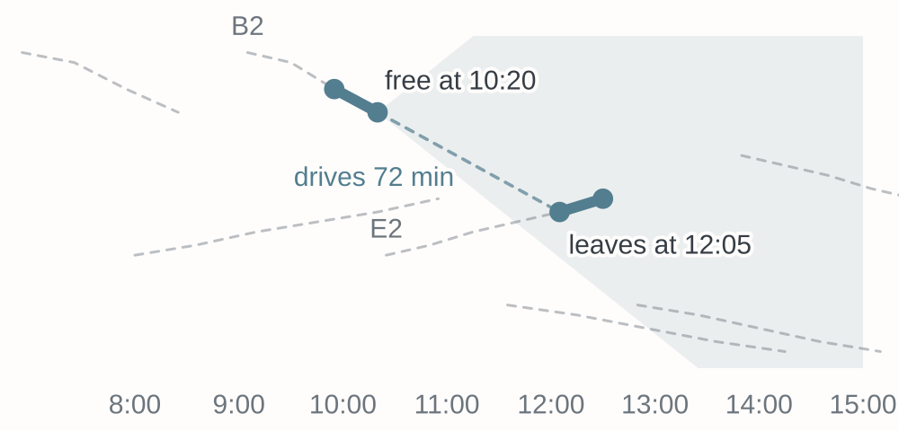{fig-align="center" width=70% fig-alt="The booking on trip B2 ends at 10:20. The shaded wedge is where its bus can still get in time. The booking on trip E2 leaves at 12:05, 72 minutes of driving away: the bus makes it."}

- Inside the shaded wedge, the bus is [in time]{.highlight}

## Your Turn

::: {.game name="buses"}
:::

# [Model Formulation]{.flow} {.title}

## Trips to Serve

[Question:]{.question} **Can one model cover all three scopes?**

. . .

- Call everything that one bus serves in one go a [trip]{.highlight} $l \in L$
- Under S1 and S2: the whole **line trips**
- Under S3: each **booking**, from its stop to its destination

. . .

::: {.callout-note}
### Note: Stops and times
A trip $l$ visits $m_l$ stops $s_1^l, \dots, s_{m_l}^l$ at the scheduled times $\bar{t}_{s_j^l}$. For a booking, only its first and last stop matter, so $m_l = 2$.
:::

## Graph Nodes?

[Question:]{.question} **What could be the nodes of our graph?**

. . .

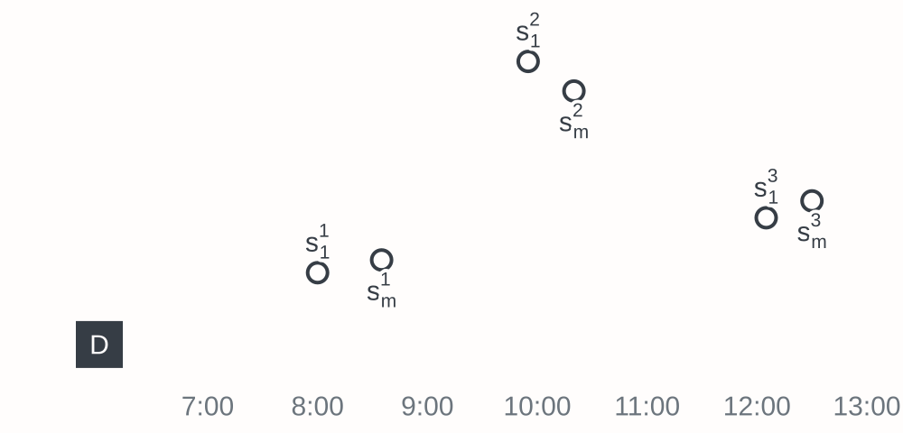{fig-align="center" width=68% fig-alt="The depot D and the first and last stop of three bookings of the class day: 1 on trip E1 at 8:00, 2 on trip B2 at 9:55, 3 on trip E2 at 12:05."}

- Depot $D$, first stops $s_1^l$, and last stops $s_{m_l}^l$

## Graph Arcs?

[Question:]{.question} **Which moves can a bus make?**

. . .

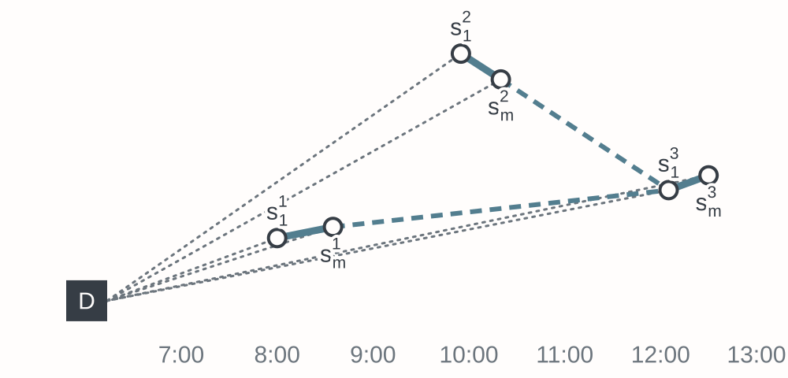{fig-align="center" width=68% fig-alt="The same nodes with dotted depot arcs, the three solid trip arcs, and two dashed connection arcs from the ends of bookings 1 and 2 to the start of booking 3; bookings 1 and 2 can't follow each other, so no arc joins them."}

- Dotted: **depot**, solid: **trip**, dashed: **connection** arcs

## Connection Arcs

A bus can go on from trip $l$ to trip $l'$ if:

$$
\bar{t}_{s_{m_l}^l} + t_{s_{m_l}^l,s_1^{l'}} \leq \bar{t}_{s_1^{l'}}
$$

. . .

[Question:]{.question} **Who can explain the condition for trips 2 and 3?**

. . .

- Trip 2 ends at $\bar{t}_{s_{m_2}^2} =$ 10:20
- The drive to trip 3 takes $t_{s_{m_2}^2,s_1^3} =$ 72 minutes
- Trip 3 leaves at $\bar{t}_{s_1^3} =$ 12:05, so the bus is [in time]{.highlight}

## The Graph

$$
V = \{D, s_1^1, \dots, s_1^n, s_{m_1}^1, \dots, s_{m_n}^n\}
$$

$$
\begin{aligned}
A = \; & \{(D,s_1^l), (s_{m_l}^l,D), (s_1^l,s_{m_l}^l) \mid l \in L\} \\
\cup \; & \{(s_{m_l}^l,s_1^{l'}) \mid l,l' \in L, \; \bar{t}_{s_{m_l}^l} + t_{s_{m_l}^l,s_1^{l'}} \leq \bar{t}_{s_1^{l'}}\}
\end{aligned}
$$

## No Way Back?

[Question:]{.question} **Can a bus ever come back to a trip it already served?**

. . .

- No, as all travel times are positive and **time only moves forward**
- Except for the depot, the graph is [acyclic]{.highlight}

## Sets and Parameters

- $L$ - Set of trips, indexed by $l$
- $m_l$ - Number of stops of trip $l \in L$
- $s_j^l$ - The $j$-th stop of trip $l \in L$
- $\bar{t}_{s_j^l}$ - Scheduled time at stop $s_j^l$
- $t_{i,j}$ - Travel time from node $i$ to node $j$
- $V$ - Set of nodes, $A$ - Set of arcs of the graph $G=(V,A)$

# [Counting Buses]{.flow} {.title}

## Decision Variable?

::: {.callout-important}
## Our goal is to:
Find the **minimum number of buses** such that **every trip is served** and every bus starts and ends its tour at the **depot**.
:::

. . .

[Question:]{.question} **What could be our decision variable?**

. . .

- $x_{ij}$ - Number of buses using arc $(i,j) \in A$

## Objective Function?

[Question:]{.question} **How can we count the buses we need?**

. . .

- Every bus leaves the depot [exactly once]{.highlight}
- So we count the buses on all arcs **leaving the depot**

. . .

$$
\text{Minimize} \quad \sum_{j:(D,j) \in A} x_{Dj}
$$

. . .

::: {.callout-note}
For trips 1 to 3, two buses suffice: one serves trip 1 and then trip 3, one serves trip 2. Two arcs leave $D$.
:::

# [Constraints]{.flow} {.title}

## Necessary Constraints

[Question:]{.question} **What constraints do we need?**

{fig-align="center" width=58% fig-alt="The graph for three bookings with depot arcs, trip arcs, and connection arcs."}

. . .

- Every bus that arrives at a node **leaves it again**
- Every trip is **served**

## Flow Conservation?

::: {.callout-important}
## The goal of this constraint is to:
Ensure that every bus that arrives at a node also leaves it again.
:::

. . .

[Question:]{.question} **What could be the constraint?**

. . .

$$
\sum_{j:(i,j) \in A} x_{ij} - \sum_{j:(j,i) \in A} x_{ji} = 0 \quad \forall i \in V
$$

. . .

::: {.callout-note}
This also holds for the depot: every bus that leaves the depot **returns** to it.
:::

## Serve All Trips?

::: {.callout-important}
## The goal of this constraint is to:
Ensure that every trip is served by exactly one bus.
:::

. . .

[Question:]{.question} **What could be the constraint?**

. . .

$$
x_{s_1^l,s_{m_l}^l} = 1 \quad \forall l \in L
$$

. . .

::: {.callout-note}
A first stop $s_1^l$ has only **one outgoing arc**, and a last stop $s_{m_l}^l$ only **one incoming arc**. Together with flow conservation, exactly one bus arrives at and leaves each trip.
:::

## Bus Line Servicing Model

::: {.temp-math-size}
```{=html}
<style>
.temp-math-size .math.display .MathJax  {
  font-size: 85% !important;
}
</style>
```

\begin{align*}
	\text{Minimize} \quad \sum_{j:(D,j) \in A} x_{Dj}
\end{align*}
subject to:
\begin{align*}
	& \sum_{j:(i,j) \in A} x_{ij} - \sum_{j:(j,i) \in A} x_{ji} = 0 && \forall i \in V \\
	& x_{s_1^l,s_{m_l}^l} = 1 && \forall l \in L \\
	& x_{ij} \geq 0 && \forall (i,j) \in A
\end{align*}

:::

# [Characteristics]{.flow} {.title}

## Characteristics

[Questions:]{.question} **On model characteristics**

::: {.incremental}
- Is the model formulation linear/ non-linear?
- What kind of variable domains do we have?
- Shouldn't the number of buses be an **integer**?
:::

## Integer for Free

- The model is a [minimum cost flow]{.highlight} problem [@bunte_overview_2009]
- Departures from the depot cost 1, all other arcs cost 0
- With integer data, the LP has an **integer optimal solution**
- The solver directly returns [whole bus tours]{.highlight}

. . .

::: {.callout-tip}
### Tip: You saw it in the game
HiGHS solved this LP for the day with 52 continuous decisions, and still returned three whole buses. Minimum cost flows are solvable in polynomial time.
:::

## Back to the Day

The best flow for all nine bookings:

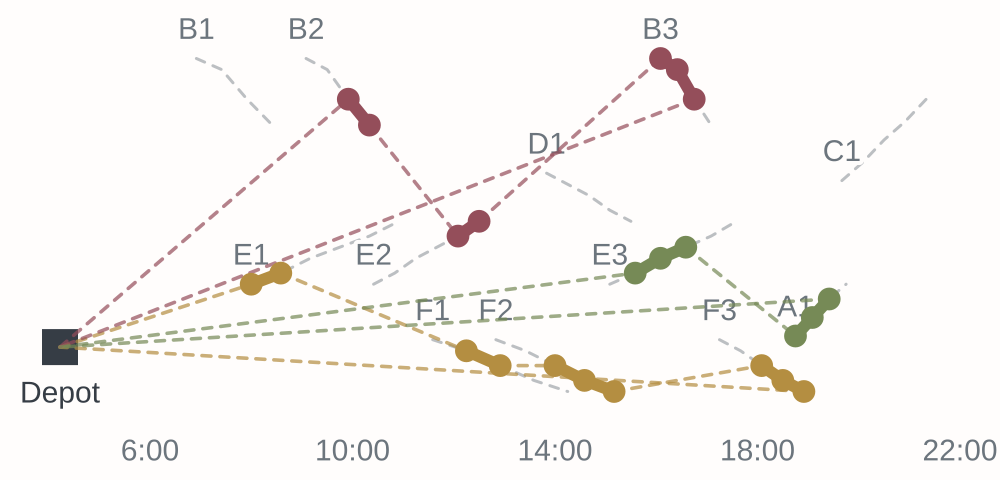{fig-align="center" width=66% fig-alt="The best plan for the class day: three buses, each in its own colour, with dashed empty drives from the depot, between their bookings and back. Bus 1 serves the bookings on E1, F1, F2 and F3; bus 2 those on B2, E2 and B3; bus 3 those on E3 and A1."}

- Three buses, each [switching between lines]{.highlight}, as in the game

## Overlapping Bookings

[Question:]{.question} **What if two bookings share a trip at once?**

::: {.r-stack}
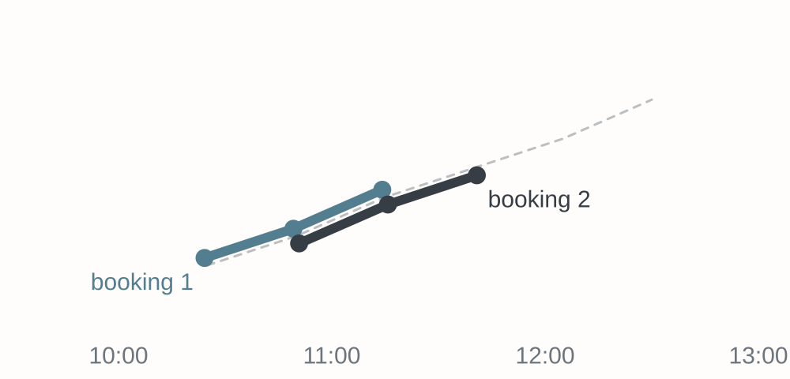{width=7.5in fig-alt="Two bookings on trip E2 overlap: one from its first to its third stop, one from its second to its fourth. In between, both ride the same bus anyway."}

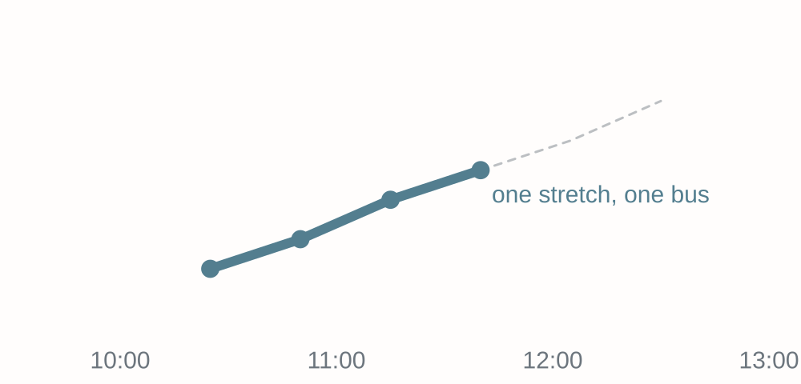{.fragment width=7.5in fig-alt="After merging, one stretch from the first to the fourth stop of trip E2 serves both bookings."}
:::

. . .

- With unlimited seats, [one bus serves both]{.highlight}

## A Real Depot

::: {.columns}
::: {.column width="50%"}
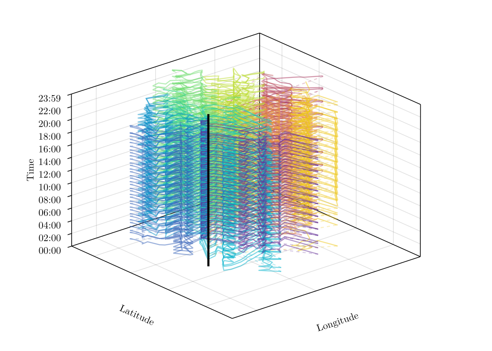{width=100% fig-alt="Space-time plot of all scheduled line trips of one depot on one day, drawn as dense colored lines between 5:00 and 23:00 around the depot, shown as a vertical black bar."}
:::
::: {.column width="50%"}
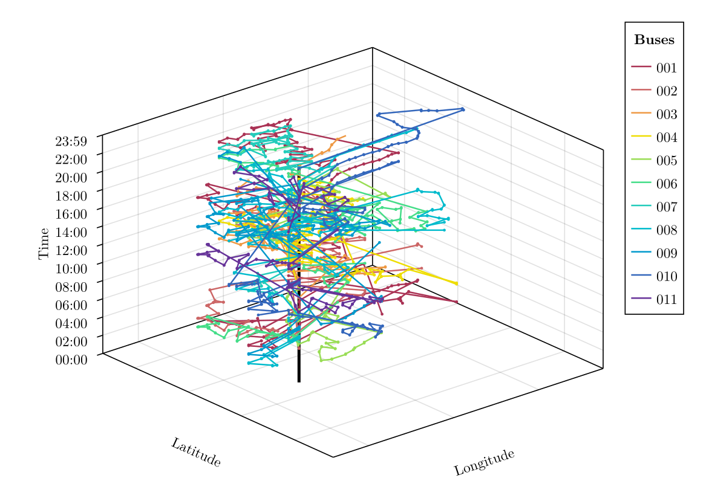{width=100% fig-alt="Space-time plot of the optimized tours under S3 for the same depot and day. Eleven bus tours, each stitching together bookings from different lines."}
:::
:::

- One real depot and day: all line trips (S1) and the fewest buses (S3)

## The Potential

[Question:]{.question} **On our day, S3 needed 3 instead of 5 buses. And in the case study?**

. . .

| Scope | Average Number of Buses |
|:---|:---:|
| S1 - All line trips | 22.8 |
| S2 - Trips with a booking | 8.7 |
| S3 - Only the bookings | [6.8]{.highlight} |

. . .

::: {.callout-important}
Serving only the bookings needs [more than 70% fewer buses]{.highlight} than a classic timetable, per depot and day, with all bookings known in advance.
:::

## {.loud-slide}
::: {.r-fit-text}
But buses have seats

and drivers need

their breaks!
:::

::: footer
:::

# [Real Operations]{.flow} {.title}

## Operational Scenarios {.smaller}

| Scenario | Buses | Seats | Shifts | Problem |
|:---|:---|:---|:---|:---|
| **O1** | Unlimited | Unlimited | None | Network flow, polynomial |
| **O2** | Unlimited | 3 or 5 seats | None | [NP-hard]{.highlight}, MIP |
| **O3.1** | Pooled across depots | 3 or 5 seats | All shift types | [NP-hard]{.highlight}, MIP |
| **O3.2** | Fixed per depot | 3 or 5 seats | Actual shifts | [NP-hard]{.highlight}, MIP |

. . .

::: {.callout-note}
### Note: Increasing realism
Each scenario adds realism. O3.2 mirrors what the operator actually has: its buses, its shifts, and its depots.
:::

## Seats (O2)

[Question:]{.question} **What changes if every bus $k$ has only $Q_k$ seats?**

. . .

- We need to know [which bus]{.highlight} serves which booking
- New binary variable $x_{ijk}$, if bus $k$ uses arc $(i,j)$
- Flow conservation now holds **for every bus**
- Each bus leaves the depot **at most once**
- Passengers on board must never exceed $Q_k$

. . .

::: {.callout-warning}
With seats, the problem becomes [NP-hard in the strong sense]{.highlight}, even if all buses are identical: @schulz_evaluation_2026 reduce 3-PARTITION [@Garey1979] to it.
:::

## Overlaps with Seats

{fig-align="center" width=30% fig-alt="Three examples of two overlapping bookings 1 and 2 on the same line trip. In each, a dashed arc leads from the end of booking 1 back to the start of booking 2 on the same line."}

- We cannot simply merge overlapping bookings anymore
- New [intraline arcs]{.highlight} let a bus go back to an earlier stop
- A new constraint keeps its **next trip** reachable in time

## Shifts and Breaks (O3)

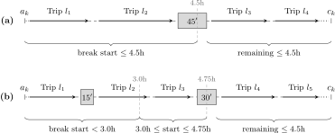{fig-align="center" width=62% fig-alt="Two break patterns for a driver shift from a_k to c_k. Pattern (a) has one 45-minute break starting within the first 4.5 hours. Pattern (b) has a 15-minute break starting before 3.0 hours and a 30-minute break starting between 3.0 and 4.75 hours. In both, the remaining driving time is at most 4.5 hours."}

- The driver of bus $k$ works a shift from $a_k$ to $c_k$
- At most [4.5 hours]{.highlight} of driving without a break
- Either one 45-minute break or 15 + 30 minutes [@boyer_vehicle_2018]

## Break Opportunities

{fig-align="center" width=95% fig-alt="A tour of bus k with five trips and gaps A to F between them. Gaps A and B qualify for the 15-minute set, gap D for the 45-minute and 30-minute sets, and gaps C, E, and F for none."}

. . .

- Gaps between trips and depot arcs serve as **breaks**
- Precompute the arcs that qualify: $\Phi_k^{45}$, $\Phi_k^{15}$, and $\Phi_k^{30}$
- A tour contains a $\Phi_k^{45}$ arc, or a $\Phi_k^{15}$ and a $\Phi_k^{30}$ arc

## Model Assumptions

[Questions:]{.question} **On model assumptions**

::: {.incremental}
- What assumptions have we made?
- What are likely issues that can arise if applied?
- Do we really know all bookings in advance?
- Can buses move between depots?
:::

# [Results]{.flow} {.title}

## Implementation

- Implemented in [Julia with JuMP]{.highlight}, solved with Gurobi
- 6 depots × 76 days = **456 instances** per scenario and scope
- **O1:** all instances solved in less than a second
- **O2:** 420 of 456 optimal under S3, only 4 under S1

. . .

::: {.callout-note}
### Note: Flexibility helps the solver as well
Under S3, the problem is not only cheaper to operate, but also much **easier to solve**.
:::

## All Bookings?

- With the actual buses and shifts (O3.2), [no single day]{.highlight} can serve all bookings at any depot, even under S3

. . .

[Question:]{.question} **What could we do instead?**

. . .

- Require only a **share of the bookings** to be served
- And ask: up to which [service level]{.highlight} is this still feasible?

## The Ceiling

| Service level | Feasible depot-days (of 456) |
|:---:|:---:|
| 60% | 398 |
| 70% | [194]{.highlight} |
| 90% | [3]{.highlight} |
| more than 90% | [0]{.highlight} |

. . .

::: {.callout-important}
With the current buses and shifts, a ceiling emerges near a [service level of 60%]{.highlight}.
:::

## Buses vs. Service Level

One curve per depot, for O3.1 (left) and O3.2 (right):

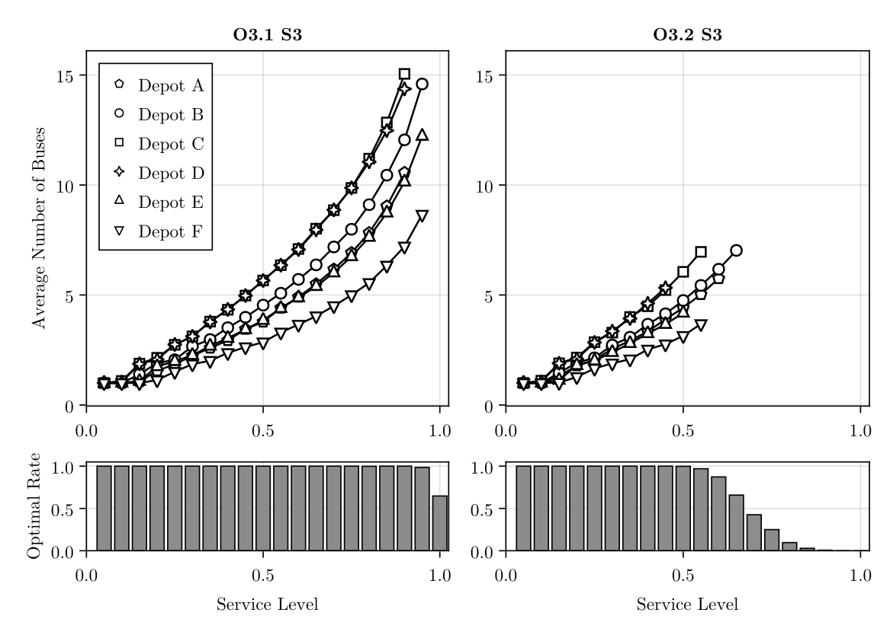{fig-align="center" width=38% fig-alt="Average number of buses versus service level for Depots A to F under O3.1 and O3.2 with S3. Under O3.1 the curves rise convexly up to about 15 buses at full service. Under O3.2 they end between 45% and 65%, and the share of optimally solved instances drops sharply beyond 60%."}

. . .

- The **last 15 points** cost over 3× as many buses per point
- Taxis could serve the [last few percent]{.highlight} much cheaper

## Beating Current Practice

White: the operator. Dark: the model, with the same buses:

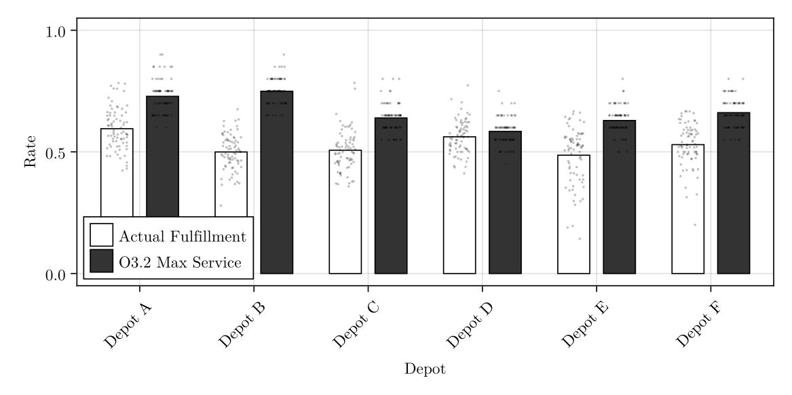{fig-align="center" width=68% fig-alt="Bar chart per depot comparing the actual service level of the operator with the maximum service level of the model under O3.2. The model is higher at every depot, with a gap from about 2 to 25 percentage points."}

. . .

- Same buses, [13.5 percentage points]{.highlight} more on average

## A Fair Comparison?

[Question:]{.question} **Is this a fair comparison?**

. . .

- No, the model knows **all bookings** of the day in advance
- The operator has to decide [when each booking arrives]{.highlight}

. . .

[Question:]{.question} **How could we use the model in day-to-day operations?**

## Rolling Horizon

::: {.incremental}
- Process all booking events in the **order they arrive**
- Re-solve the model with the new booking added
- Feasible? [Confirm]{.highlight} it, otherwise reject it for good
- A cancellation removes its booking and frees capacity
- Assignments departing within **60 minutes** are fixed
:::

. . .

::: {.callout-tip}
### Tip: Only the assignments are fixed
The rest of each tour, including breaks and depot arcs, stays flexible.
:::

## Rolling Horizon Results

Grey: the rolling horizon, between operator and optimum:

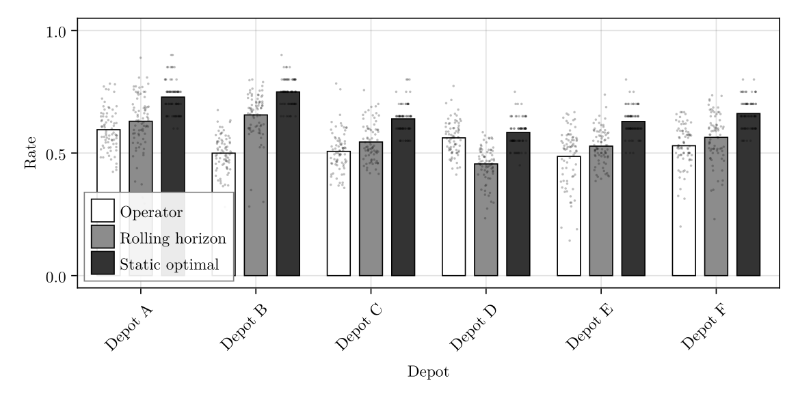{fig-align="center" width=56% fig-alt="Bar chart per depot comparing the service level of the operator, the rolling horizon, and the static optimum under O3.2. The rolling horizon beats the operator at five of six depots, and the static optimum is highest everywhere."}

. . .

- Average service level of 56.3%, [+3.3 percentage points]{.highlight}
- Only **0.06 seconds** per booking event

## The Remaining Gap

[Question:]{.question} **Why is the rolling horizon about 10 points below the static optimum?**

. . .

- Most of it comes from [cancellations]{.highlight}, which block seats until canceled
- Each booking is confirmed if feasible, **without looking ahead**

. . .

::: {.callout-note}
### Note: Long lead times help
The median booking is made **8.7 hours** before departure. Thus, the solver can still rearrange most of the day for each new booking.
:::

## Wrap Up

- Our day: the timetable needs **5 buses**, the bookings [3]{.highlight}
- A network flow finds them in **milliseconds**
- Seats, shifts, and breaks make the problem **NP-hard**
- Real shifts cap the service level near [60%]{.highlight}
- Optimization serves **more bookings** with the same buses

. . .

::: {.callout-note}
## And that's it for today's lecture!

We now have covered an on-demand bus service based on a real-world case and are ready to start solving some new tasks in the upcoming tutorial.
:::

## {.loud-slide}
::: {.r-fit-text}
Questions?
:::

::: footer
:::

# [Literature]{.flow} {.title}

## Literature I

References for this lecture:

- @schulz_evaluation_2026: Models and case study
- @vansteenwegen_survey_2022: Demand-responsive buses
- @errico_survey_2013: Semi-flexible transit
- @bunte_overview_2009: Vehicle scheduling
- @boyer_vehicle_2018: Flexible bus scheduling

## Literature II

For more interesting literature to learn more about Julia, take a look at the [literature list](../general/literature.qmd) of this course.
